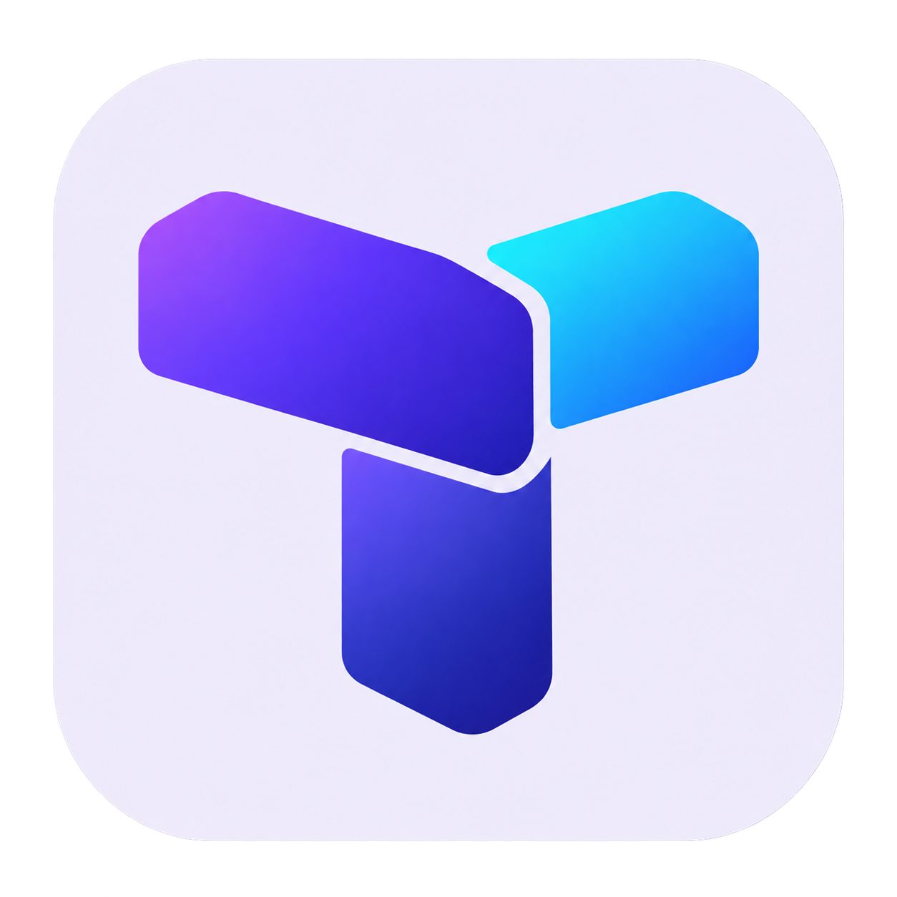

[English](./README.md) | **简体中文**

<p align="center">
  
</p>

<div align="center">

# Tuolola Element Components

<p>
  <strong>Tuolola 组件项目的托管入口</strong><br />
  可复用组件项目的文档与托管起点。<br />
  <sub>项目标识 · 双语文档 · MIT 协议</sub>
</p>

<p>
  <a href="#快速开始"></a>
  <a href="https://github.com/guolola/tuolola-element-components/issues"></a>
  <a href="./LICENSE"></a>
</p>

<p>
  
  
</p>

> 用可复用的模块组织界面。本仓库先建立项目标识与文档入口，组件源码将在后续补充。

</div>

## 项目介绍

本仓库是 **Tuolola Element Components** 的项目首页。

迁移时，[Gitee 原仓库](https://gitee.com/guolola/tuolola-element-components) 没有 Git 提交、分支或源文件。因此 GitHub 仓库先提供项目文档与 MIT 协议，尚无组件实现或可安装的软件包。

[当前状态](#当前状态) · [项目范围](#项目范围) · [开发流程](#开发流程) · [快速开始](#快速开始)

## 当前状态

| 内容 | 状态 |
| --- | --- |
| 中英文项目介绍 | 已提供 |
| MIT 开源协议 | 已提供 |
| 组件源码与使用示例 | 待补充 |
| 包配置与构建配置 | 待补充 |
| npm 包与组件 API | 尚未提供 |

## 项目范围

项目目前处于仓库准备阶段，现有成果是带独立 Logo、中英文介绍和 MIT 协议的源码托管入口。

| 已准备 | 随实现补充 |
| --- | --- |
| 项目标识与仓库文档 | 组件源码与框架要求 |
| 英文和简体中文入口 | API 参考和使用示例 |
| MIT 协议 | 包配置、本地开发和构建脚本 |

## 开发流程

1. 添加原始组件实现，并保留第三方声明。
2. 根据源码定义包配置、框架版本与构建入口。
3. 为每个支持的组件提供可运行的小型使用示例。
4. 根据实际实现编写公共 API、验证命令和版本发布说明。

以上是后续贡献步骤，并非仓库中已经实现的功能。

## 快速开始

克隆仓库以查看文档：

```bash
git clone https://github.com/guolola/tuolola-element-components.git
cd tuolola-element-components
```

目前没有依赖安装、开发服务或构建命令。实际源码补充后，再根据项目配置添加启动说明。

## 补充源码

将原始实现提交到本仓库后，补充真实的框架要求、组件 API、使用示例、安装与构建步骤。

## 架构与文档

| 路径 | 内容 |
| --- | --- |
| `README.md` | 英文项目介绍 |
| `readme-zh-cn.md` | 简体中文介绍 |
| `docs/brand/logo.png` | 项目 Logo |
| `LICENSE` | MIT 协议 |

组件架构、依赖版本和运行命令会随真实源码补充。

## 开源协议

[MIT](./LICENSE) · Copyright © 2026 guolola。
